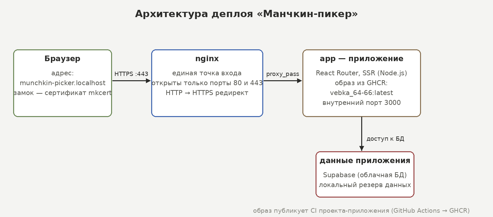

# Деплой «Манчкин-пикер» (репетиция)

Репетиция деплоя проекта «Манчкин-пикер» (практическое занятие №18):
стек развёрнут локально так, как он был бы развёрнут на сервере
(готовый образ приложения, веб-сервер nginx, HTTPS с локальным
сертификатом, локальное доменное имя, переменные окружения), но **без
публикации в Интернет** — в соответствии с требованиями 152-ФЗ
«О персональных данных» для учебных проектов.

Репозиторий приложения: https://github.com/NoNeme-netizen/vebka_64-66



## Схема архитектуры

Браузер → **nginx** (единая точка входа, порты 80/443, TLS) → **app**
(веб-приложение React Router с SSR, внутренний порт 3000, наружу не
опубликован) → **Supabase** (облачная БД PostgreSQL; при недоступности —
локальный резерв данных внутри приложения).

## Доставка образа (CD)

Этот репозиторий не содержит исходного кода приложения и ничего не
собирает: CI проекта-приложения (GitHub Actions, workflow `build.yml`)
после каждого слияния в `main` проверяет типы, собирает Docker-образ и
публикует его в GitHub Container Registry:

```
docker pull ghcr.io/noneme-netizen/vebka_64-66:latest
```

Compose-файл этого репозитория использует этот же образ — то есть здесь
реализован этап доставки приложения из реестра образов (CD): после
обновления образа в GHCR достаточно выполнить `docker compose pull` и
перезапустить контейнеры.

## Сервисы

| Сервис | Технология | Внутренний порт | Продакшен-сервер | Порты наружу |
|---|---|---|---|---|
| `nginx` | nginx:alpine (обратный прокси) | 80, 443 | сам является веб-сервером | **80, 443** |
| `app` | Node.js 24, react-router-serve (образ из GHCR) | 3000 | Node.js-сервер (встроен) | нет |

## Домен и сертификат

- локальное доменное имя: `munchkin-picker.localhost`;
- сертификат выпущен утилитой mkcert (локальный центр сертификации);
- файлы сертификата кладутся в папку `certs/` (в репозиторий не
  попадают — см. .gitignore);
- имя домена совпадает в трёх местах: команда mkcert, `server_name` и
  пути `ssl_certificate*` в `nginx/nginx.conf`.

## Переменные окружения и секреты (только имена, без значений)

| Имя | Назначение | Где задаётся |
|---|---|---|
| `PORT` | внутренний порт приложения | docker-compose.yml |
| `SESSION_SECRET` | секрет подписи cookie-сессии | `.env` рядом с docker-compose.yml (этап запуска) |
| `SUPABASE_URL` | адрес проекта Supabase (облачная БД) | `.env` рядом с docker-compose.yml |
| `SUPABASE_SERVICE_ROLE_KEY` | серверный ключ доступа к Supabase (секрет!) | `.env` рядом с docker-compose.yml |

Секретные значения не включаются в образ и не хранятся в коде: они
передаются в контейнер только на этапе запуска через переменные
окружения (шаблон — `.env.example`). Если переменные Supabase не заданы,
приложение работает на локальном резерве данных.

## Команды

```bash
# 1. выпуск сертификата (один раз; из папки certs)
mkcert -cert-file munchkin-picker.localhost.pem \
       -key-file munchkin-picker.localhost-key.pem munchkin-picker.localhost

# 2. создать .env (по образцу .env.example) с ключами Supabase

# 3. запуск (из папки репозитория)
docker compose up -d

# обновление до свежей версии приложения
docker compose pull && docker compose up -d

# проверка: оба сервиса должны быть Up
docker compose ps

# журналы при диагностике
docker compose logs app
docker compose logs nginx

# остановка
docker compose down
```

Проверка в hosts не требуется: домены `*.localhost` Windows разрешает в
адрес 127.0.0.1 автоматически.

## Проверка работы

- адрес: **https://munchkin-picker.localhost** — открывается без
  предупреждений о сертификате (замок в адресной строке), HTTP
  автоматически перенаправляется на HTTPS;
- порты открыты только у контейнера nginx (Docker Desktop);
- скриншоты проверки — в папке `screenshots/`.

## Ошибки при выполнении и их устранение

- `failed to read dockerfile` — выполнялась ручная сборка из чужой
  папки; в этом репозитории сборка не используется вообще: образ
  скачивается из GHCR командой `docker compose up -d`;
- предупреждение о сертификате в браузере — не совпадало имя домена
  между mkcert, `server_name` и путями сертификата; после выпуска
  сертификата с тем же именем устранено;
- HTTP вместо HTTPS — набран адрес `http://…`; nginx настроен на
  редирект 301 на HTTPS;
- `TypeError: fetch failed` в журнале приложения — недоступность
  Supabase с данного компьютера; приложение автоматически переходит на
  локальный резерв данных (сообщение `[БД] Supabase: …` в журнале).

## Что нужно изменить для публикации на реальном сервере

1. Арендовать сервер (VPS) у хостинг-провайдера, соответствующего
   требованиям 152-ФЗ (хранение данных на серверах в РФ), и настроить
   SSH-доступ.
2. Зарегистрировать доменное имя в DNS и направить его на IP сервера
   (заменив локальный `munchkin-picker.localhost` на реальный домен).
3. Выпустить сертификат у публичного центра сертификации (Let's Encrypt,
   certbot) вместо локального mkcert.
4. Заменить в nginx.conf `server_name` и пути сертификата; на сервере
   клонировать этот репозиторий деплоя, заполнить `.env` и выполнить
   `docker compose up -d` — образ приложения скачается из GHCR.
5. Настроить доставку обновлений (CD): после merge в main CI публикует
   новый образ в GHCR, на сервере достаточно `docker compose pull &&
   docker compose up -d` (по webhook или по расписанию).

## Дополнительное задание

Публикация образа в GitHub Container Registry из CI настроена в
репозитории приложения (занятие 64-66): workflow `.github/workflows/build.yml`
после проверки типов собирает образ и публикует его с тегами `latest` и
хэшем коммита; поддерживается ручной запуск (workflow_dispatch).
