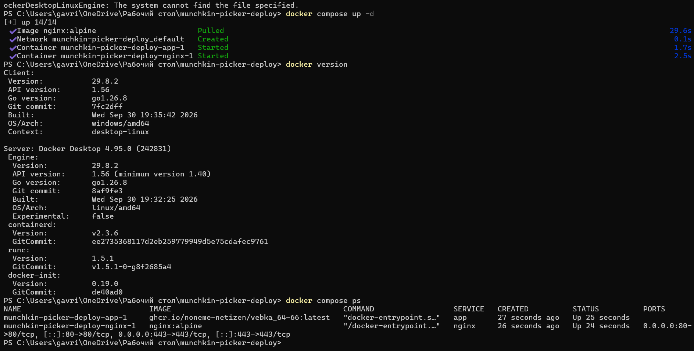
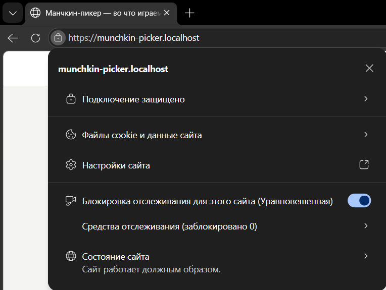
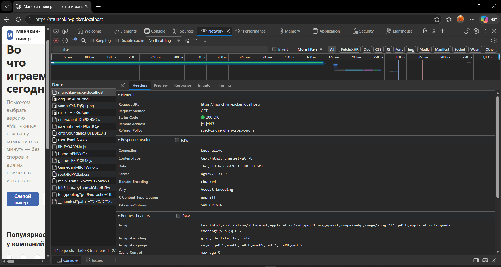
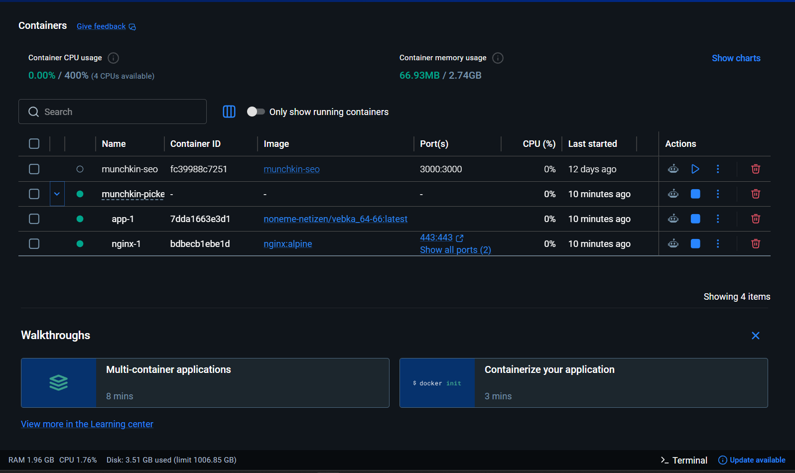
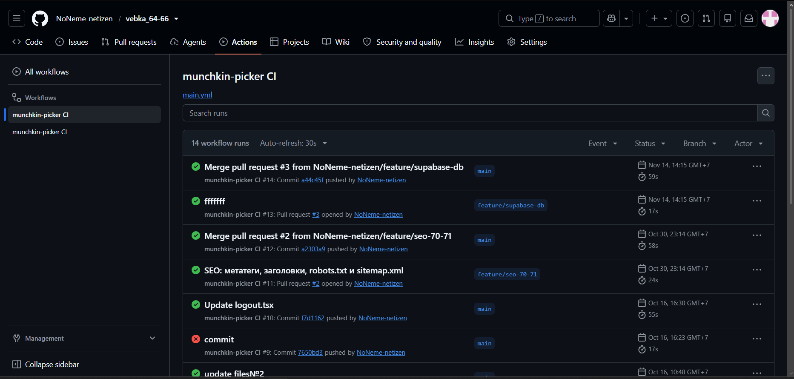
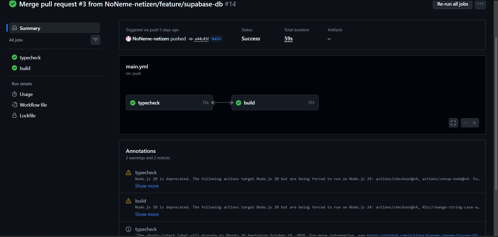

# Деплой «Манчкин-пикер» (репетиция)

Репетиция деплоя проекта «Манчкин-пикер» (практическое занятие 76-78):
стек развёрнут локально так, как он был бы развёрнут на реальном сервере
(готовый образ приложения, веб-сервер nginx, HTTPS с локальным
сертификатом mkcert, локальное доменное имя, секреты в переменных
окружения), но **без публикации в Интернет** — в соответствии с
требованиями 152-ФЗ «О персональных данных» для учебных проектов.

Репозиторий приложения: https://github.com/NoNeme-netizen/vebka_64-66

Перед отправкой выполнена команда `git status`: файлы `.env`, файлы
ключей и папка сертификатов `certs/` в репозиторий не попали.

## 1. Схема архитектуры проекта

Браузер → **nginx** (единая точка входа, HTTPS, порты 80/443) → **app**
(веб-приложение Node.js с SSR, внутренний порт 3000, наружу не
опубликован) → **Supabase** (облачная база данных PostgreSQL). Готовый
образ приложения скачивается из реестра GHCR (его публикует CI
репозитория приложения).


## 2. Таблица сервисов

| Сервис | Технология | Внутренний порт | Продакшен-сервер | Порты наружу |
|---|---|---|---|---|
| `nginx` | nginx:alpine (обратный прокси, TLS-терминация) | 80, 443 | сам является веб-сервером | **80, 443** |
| `app` | Node.js 24 (образ из GHCR, React Router + SSR) | 3000 | react-router-serve (встроен в Node.js) | нет |

Фронтенд и бэкенд проекта — одно фуллстек-приложение (серверный
рендеринг, обработка форм и доступ к БД выполняются одним процессом
Node.js), поэтому отдельного API-сервиса нет: в nginx остаётся один
`location /`, который передаёт все запросы сервису приложения. Каждый
сервис работает в своём контейнере (docker compose).

## 3. Переменные окружения и секреты (только имена, без значений)

| Имя | Назначение | Где задаётся |
|---|---|---|
| `PORT` | внутренний порт приложения | docker-compose.yml |
| `SESSION_SECRET` | секрет подписи cookie-сессии | `.env` рядом с docker-compose.yml |
| `SUPABASE_URL` | адрес облачной БД Supabase | `.env` рядом с docker-compose.yml |
| `SUPABASE_SERVICE_ROLE_KEY` | серверный ключ доступа к Supabase (секрет) | `.env` рядом с docker-compose.yml |

Секретные значения не включаются в образ и не хранятся в коде: они
передаются в контейнер только на этапе запуска через переменные
окружения из файла `.env` (создаётся по шаблону `.env.example` и
исключён из репозитория). Если переменные Supabase не заданы,
приложение работает на локальном резерве данных и не перестаёт
работать.

## 4. Команды запуска и остановки

```bash
# 1. выпуск сертификата (один раз; утилита mkcert, из папки certs)
mkcert -install
mkcert -cert-file munchkin-picker.localhost.pem \
       -key-file munchkin-picker.localhost-key.pem munchkin-picker.localhost

# 2. создать .env по образцу .env.example (ключи Supabase, SESSION_SECRET)

# 3. запуск (образ приложения скачивается из GHCR автоматически)
docker compose up -d

# проверка: оба сервиса должны быть в состоянии Up
docker compose ps

# журналы при диагностике
docker compose logs app
docker compose logs nginx

# обновление до свежей версии приложения (доставка из реестра образов, CD)
docker compose pull && docker compose up -d

# остановка
docker compose down
```

Домены `*.localhost` Windows разрешает в адрес 127.0.0.1 автоматически —
правка файла hosts не требуется. Проверка выполнялась в Chrome
(mkcert не добавляет сертификат в Firefox). Имя домена совпадает в трёх
местах: команда mkcert, `server_name` и пути `ssl_certificate` в
nginx.conf.

## 5. Скриншоты проверки

### 5.1. Вывод команды docker compose ps

Оба сервиса Up; у `app` столбец PORTS пуст (приложение наружу не
опубликовано), порты 80/443 открыты только у nginx.



### 5.2. Страница проекта по адресу https://munchkin-picker.localhost

Замок в адресной строке, «Подключение защищено» — сертификат mkcert
доверенный; HTTP автоматически перенаправляется на HTTPS (редирект 301).



### 5.3. Вкладка Network: запрос и заголовки ответа

Запрос документа к единой точке входа: статус 200 OK, Remote Address
[::1]:443 (nginx по HTTPS), в заголовках ответа — сервер nginx/1.31.9 и
добавленные им заголовки безопасности X-Frame-Options и
X-Content-Type-Options. Отдельного запроса к API в проекте нет —
приложение фуллстек (SSR), все данные формируются на сервере
приложения; все запросы страницы обслуживаются nginx и передаются
приложению по внутреннему порту.



### 5.4. Список контейнеров в Docker Desktop с открытыми портами

Контейнер app-1 (образ noneme-netizen/vebka_64-66:latest) не имеет
опубликованных портов; порты открыты только у контейнера nginx-1
(443:443) — наружу доступна только единая точка входа.



## 6. Дополнительное задание: workflow GitHub Actions

Публикация образа из CI настроена в репозитории приложения
(.github/workflows/build.yml): при push и Pull Request выполняются
typecheck и сборка, после слияния в main образ публикуется в GitHub
Container Registry (теги latest и хэш коммита); поддерживается ручной
запуск (workflow_dispatch). Скриншот успешного выполнения workflow:



Шаги прогона: typecheck (15 с) → build (37 с) — сборка выполняется
только после успешной проверки типов. Этот прогон обновил образ в GHCR,
который затем скачан репозиторием деплоя при запуске стека.



## 7. Ошибки, возникшие при выполнении работы, и их устранение

1. **«failed to connect to the docker API … The system cannot find the
   file specified»** при выполнении docker compose up — Docker Desktop
   не был запущен, демон недоступен. Устранение: запуск Docker Desktop и
   ожидание статуса «Engine running», после чего команды выполнены
   успешно.

2. **«Имя ".\mkcert.exe" не распознано как имя командлета»** — команда
   выполнялась из каталога C:\WINDOWS\system32, в котором файла
   mkcert.exe нет; PowerShell ищет исполняемый файл в текущей папке.
   Устранение: утилита скачана с официальной страницы релизов GitHub
   (Invoke-WebRequest) в отдельную папку; команды выполняются из этой
   папки либо с указанием полного пути.

3. **«Invalid path specified in request URL»** при работе с облачной
   базой — в переменную SUPABASE_URL при ручном наборе попал лишний
   хвост пути /rest/v1/, который клиент дописывает сам. Устранение: URL
   копируется из Settings → Data API; в приложение добавлена
   нормализация адреса (лишние хвосты срезаются).

4. **Предупреждение о сертификате в браузере** — возможная ошибка при
   несовпадении имени домена между mkcert, server_name и путями
   ssl_certificate (в этом случае nginx не стартует либо браузер не
   доверяет сертификату). В работе имя munchkin-picker.localhost
   совпадает во всех трёх местах — предупреждений нет.

5. **«GH013: Repository rule violations found — GITHUB PUSH PROTECTION:
   Push cannot contain secrets»** при отправке в GitHub — при заполнении
   шаблона .env.example в него ошибочно был внесён настоящий ключ
   Supabase, и GitHub отклонил отправку (секрет при этом не попал в
   репозиторий — защита сработала до записи). Устранение: шаблон
   восстановлен с пустыми значениями, ключ перенесён в игнорируемый
   файл .env; поскольку секрет остался в более раннем локальном
   коммите, история переписана (git reset --soft до последнего
   успешно отправленного коммита, изменения закоммичены заново одним
   коммитом без секрета), после чего отправка прошла успешно.
   Ссылкой «allow the secret» (публикация секрета) не пользовались.

## 8. Что нужно изменить, чтобы опубликовать проект на реальном сервере

1. Арендовать сервер (VPS) у хостинг-провайдера, соответствующего
   требованиям 152-ФЗ (хранение персональных данных на серверах в РФ),
   и настроить SSH-доступ.
2. Зарегистрировать доменное имя и направить его в DNS на IP-адрес
   сервера; заменить локальное имя munchkin-picker.localhost на реальный
   домен в mkcert и в nginx.conf (server_name и пути сертификата).
3. Выпустить сертификат у публичного центра сертификации (Let's Encrypt,
   certbot) вместо локального mkcert.
4. На сервере клонировать репозиторий деплоя, заполнить .env боевыми
   значениями секретов и выполнить `docker compose up -d` — образ
   приложения скачается из GHCR.
5. Настроить доставку обновлений (CD): после слияния в main CI
   публикует новый образ в GHCR; на сервере достаточно выполнять
   `docker compose pull && docker compose up -d` по расписанию или по
   webhook.
